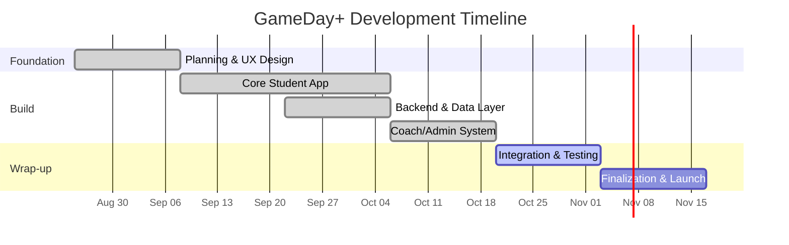

# GameDay+ — Week 5: Project Timeline & Milestones

**Team Members:** William Eaton, Logan Cook

---

## Part 1 — Project Timeline & Milestones

### Project Summary

**GameDay+** is a zero-login high-school sports and events hub. It solves the problem
of students never knowing when and where upcoming games are happening, how to get to
away games, and what the latest scores and stats are. The app is built so any student
can open it on a phone, tablet, or laptop and immediately see upcoming events, maps,
directions, schedules, and statistics — with no password or signup.

### Phase Timeline

| Phase | Focus | Est. Duration | Milestone (how we know we're on track) | Owners | Status |
| --- | --- | --- | --- | --- | --- |
| **1. Planning & UX Design** | Define problem, core features, and visual direction | 2 weeks | Wireframes + confirmed feature list + clickable navigation skeleton | William + Logan | ✅ Complete |
| **2. Core Student App** | Schedule, calendar, sports filter, stats, maps, theme switcher | 4 weeks | Public app renders events with all filters and views working in-browser | William + Logan | ✅ Complete |
| **3. Backend & Data Layer** | Firebase setup, shared data model, shared data layer, seed data | 2 weeks | One Firestore collection reads end-to-end into the public app | William + Logan | ✅ Complete |
| **4. Coach/Admin System** | Admin page, create/edit/delete, auth + security rules | 2 weeks | Admin can sign in and write data; public users cannot | William + Logan | ✅ Complete |
| **5. Integration & Testing** | Wire every feature to the shared data; unit + security rule tests | 2 weeks | A single data change propagates to Schedule, Calendar, Stats, Maps | William + Logan | 🔄 In Progress |
| **6. Finalization & Launch** | Production config, build, deploy to Firebase Hosting, live verification | 2 weeks | Live deployed URL passes the full feature checklist | William + Logan | ⬜ Remaining |

**Total estimated duration:** ~14 weeks, with Phases 3–4 run in parallel and Phase 5
overlapping Phase 2's polish work.

### Milestones

| # | Milestone | Target Phase | Status |
| --- | --- | --- | --- |
| M1 | Problem and feature list locked | Phase 1 | ✅ Met |
| M2 | Full clickable UI (schedule, calendar, stats, map, themes) | Phase 2 | ✅ Met |
| M3 | Firestore `events` collection working end to end (public read → app) | Phase 3 | ✅ Met |
| M4 | Admin can create/edit/delete and write to Firestore; rules block public writes | Phase 4 | ✅ Met |
| M5 | Single source of truth: one data change updates every feature | Phase 5 | 🔄 In Progress |
| M6 | All automated tests passing (unit + Firestore rules) | Phase 5 | 🔄 In Progress |
| M7 | Live deployed app verified on phone + desktop | Phase 6 | ⬜ Remaining |

### Gantt View



### Development Feature Breakdown

Development was broken down feature by feature, then each feature was connected to the
shared data layer:

| Feature | Description | Status |
| --- | --- | --- |
| Theme Switch | Light mode, Dark (OLED) mode, and School Spirit mode | ✅ Working |
| Sports Filter Bar | Filter by All / Football / Basketball / Soccer / Baseball-Softball / Volleyball / Track / Cheer & Clubs, plus Upcoming/Today/Past and Away-only | ✅ Working |
| Schedule & Scores | Current, past, and future games with scores and status | ✅ Working |
| Calendar | Month and week grid views; day selection; Google Calendar + .ics export | ✅ Working |
| Away Maps & Directions | Leaflet map of home/away venues; distance + ETA; 1-click routing to Google/Apple/Waze; parking and gate info | ✅ Working |
| Statistics & Box Scores | Period-by-period scoring, star player, records, standings, streaks | ✅ Working |
| Coach/Admin Page | Sign-in page to manage events, sports, clubs, teams, statistics, settings | ✅ Working |
| Firebase / Firestore | Shared data layer with authenticated admin writes and public reads | ✅ Working |

---

## Part 2 — Tech Deliverable: Firestore End-to-End

### What we built

We added **Cloud Firestore** to GameDay+ and got **one collection working end to
end**: the **events** collection.

- **Storage path:** `schools/{schoolId}/events/{eventId}`
- **Public read:** the student-facing app reads events directly from Firestore. If
  Firestore is unavailable it falls back to a local `data/events.json` dataset so
  development never stops.
- **Admin write:** authorized administrators sign in and create/edit/delete events
  from the admin dashboard. Writes are rejected for everyone else.

### The full data flow

```
Admin (admin.html)  →  Firestore: schools/{schoolId}/events  →  firebase-client.js  →  Schedule / Calendar / Stats / Maps
```

### Code / files that are the evidence

| File | Role |
| --- | --- |
| `assets/js/firebase-config.js` | Firebase project connection config |
| `assets/js/firebase-client.js` | Shared data layer — loads events from Firestore (`GameDayFirebase.loadEvents()`) with local fallback |
| `firestore.rules` | Security rules: public read of `events` + `settings/school`, admin-only writes via custom claims |
| `admin.html` + `assets/js/admin.js` | Admin sign-in and management UI (events, sports, clubs, teams, statistics, settings) |
| `signin.html` + `assets/js/signin.js` | Coach/admin authentication |
| `services/seed-firestore.js` | Seeds the `events` collection from `data/events.json` |
| `services/seed-all-schools.js` | Seeds schedules for all schools via Firestore REST API |
| `services/set-claims.js` | Mints the `admin` / `school` custom claims used by the rules |
| `data/events.json` | Realistic development/test dataset for the events collection |
| `tests/rules/firestore.rules.test.js` | Automated tests that prove only admins can write and the public can read `events` |
| `tests/unit/*` | Unit tests for escaping, credentials, and render safety |

### How to verify it

1. Deploy rules: `firebase deploy --only firestore:rules`
2. Seed data: `npm run seed:firestore`
3. Open the app → events load from Firestore (`isLiveFirestore: true`).
4. Open `admin.html` → sign in → create or edit an event → it appears in the public app.
5. Run tests: `npm test` and the Firestore rules suite.

> **Screenshots / live URL:** add a screenshot of the Firestore console showing
> documents under `schools/sugar-salem/events`, a screenshot of `admin.html`, and/or
> the deployed Firebase Hosting URL.

---

## Part 3 — Submission Package

### Team members
1. William Eaton
2. Logan Cook

### What the team produced this week
- A **project timeline with phases and milestones** (Part 1 above).
- A working **Firestore-backed events collection** wired end to end into the
  student-facing app, with an **authenticated admin dashboard** for managing data and
  **security rules** restricting writes to admins.

### Personal contributions

**William Eaton**
> This week I worked on getting our Firebase and Firestore stuff set up so the app could actually store and read real data instead of just using the sample stuff. I connected the events collection to the app and made sure the admin page could sign in and add or edit games, and I also helped write the security rules so random people can't change the data. Getting the data to show up right everywhere was honestly kind of annoying at first but I figured it out and it works now.

**Logan Cook**
> _Logan will upload his own contribution._

### What didn't work (fill in if applicable)
> _If any part of this week's work got stuck, describe what you tried and where you
> got stuck. Explaining an honest blocker counts toward the grade._
